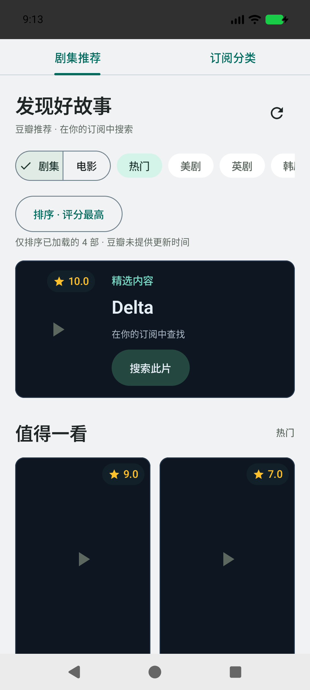
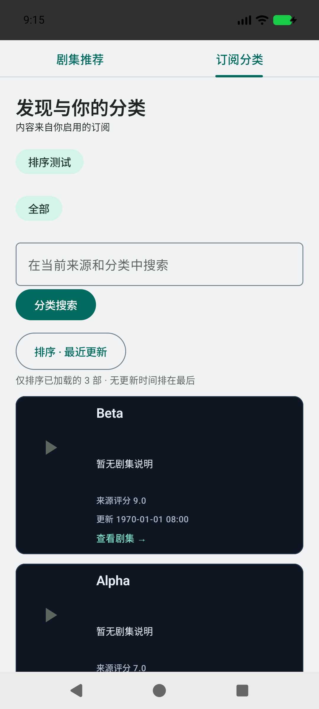

# v0.19.0 · 发现排序

推荐与订阅分类均提供默认顺序、评分最高、名称排序；分类额外提供最近更新。排序仅作用于已加载数据（含追加页），不冒充全来源排名。菜单下方显示已加载数量和缺失数据规则。默认顺序直接使用原始列表，不修改缓存、分页游标或来源顺序。

评分使用推荐 `rate` 或分类 `vod_score`，只接受大于 0 且不超过 10 的有限数值。更新时间使用分类 `vod_time`，支持 10 位秒时间戳、13 位毫秒时间戳、ISO 时间、日期和 `yyyy-MM-dd HH:mm:ss`。不将年份、更新集数或本地抓取时间当作更新时间；无时区的 CMS 时间统一按 Asia/Shanghai 解释，有明确时区的时间保留其瞬间。非法值按缺失处理。

同分、同时间保持来源原始相对顺序；缺失值置后。名称使用中文区域排序规则。豆瓣推荐没有提供更新时间，相关菜单项禁用并明确提示。来源评分与更新时间在分类卡片中显示，便于核对顺序。

排序为显示层操作，不触发额外请求；切换标签保留各自选择，Activity 状态恢复使用 rememberSaveable。不会永久保存为全局设置，也不改变历史记录的排列或断点。新增元数据不写入历史存储，旧数据格式兼容。

## 验证

- 100 项单元测试通过，新增覆盖数值评分、缺失值后置、同值稳定、追加页参与、默认恢复、中文区域排序入口、推荐评分元数据与 CMS 时间解析边界。
- 排序设备测试通过：评分首位变化、新页高分加入、恢复默认、豆瓣更新时间禁用、分类新到旧顺序、切换标签保留选择。
- 标准手机、大字体 320dp / 150%、夜间与 1280×800dp 宽屏回归通过，原搜索、推荐刷新、卡片布局与续播断点通过。
- 原证书 v2/v3 签名验证通过，正式包完成 v0.18.0（24）→ v0.19.0（25）覆盖安装与冷启动。
- debug、androidTest 与 release 构建、release lint 通过；正式包不含测试媒体、测试安装包、私钥或预置播放源。

测试使用 API 37 模拟器及合成数据；未覆盖真实来源的所有非标准时间格式或实体手机矩阵。

