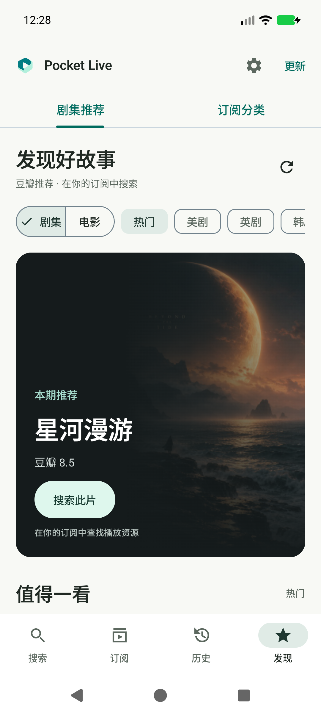
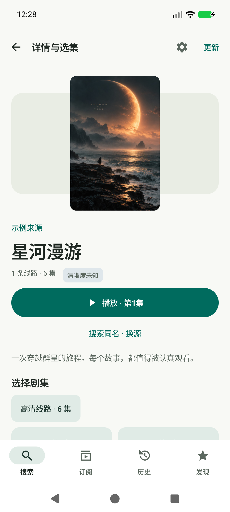
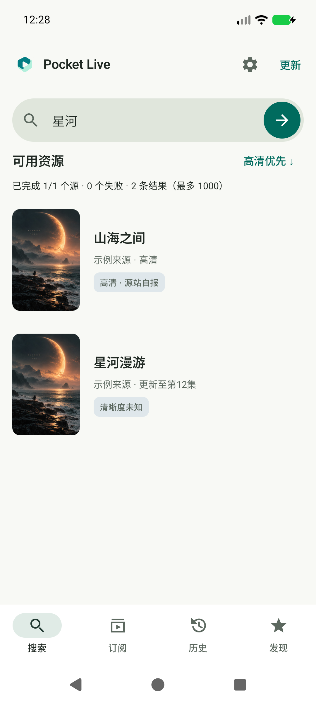
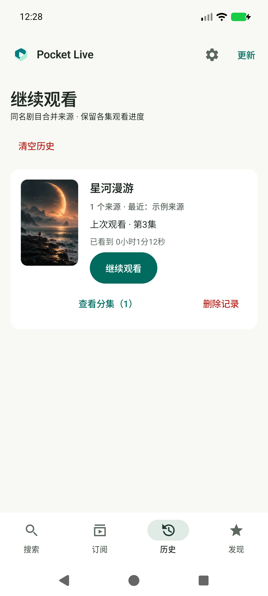
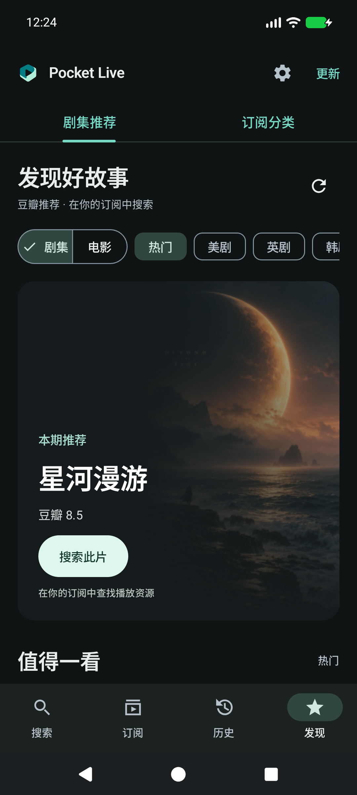
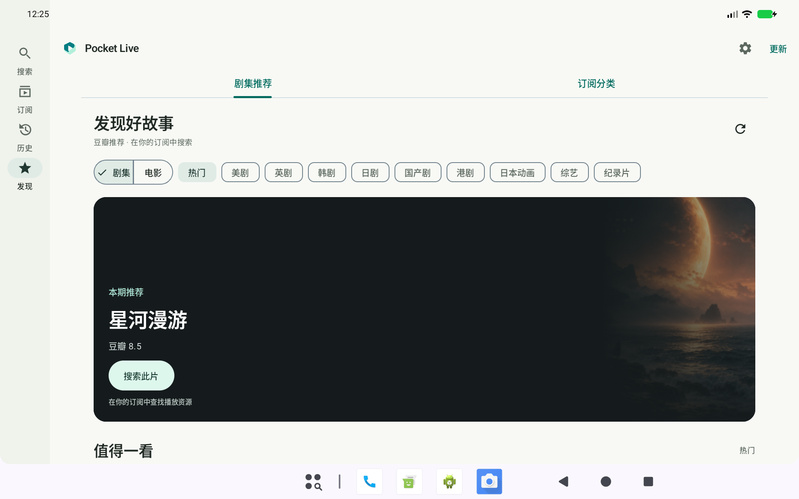
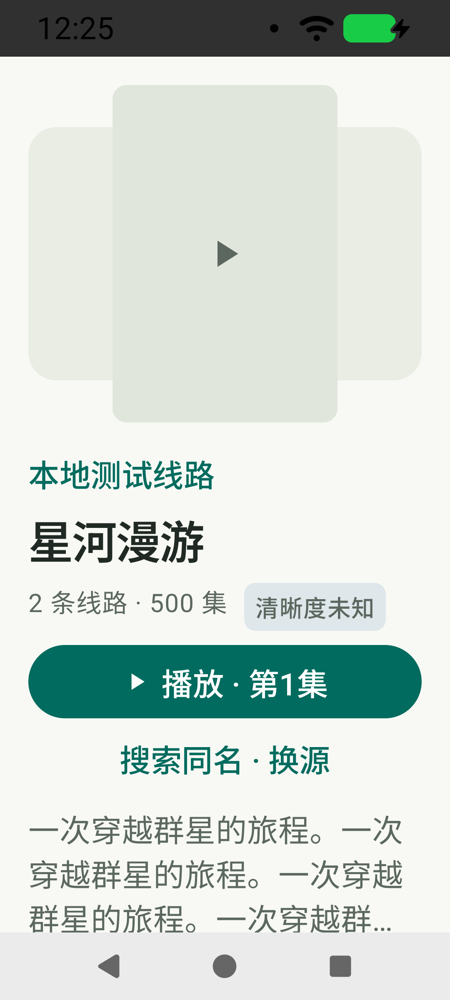

# v0.10.0 · 内容优先的视觉重设计

## 调研依据

研究官方页面及其中的产品截图，不以概念稿代替实际产品体验：

- [Infuse 8 官方设计介绍](https://firecore.com/blog/infuse-8-now-available)：封面和画面承担视觉重心，标题、元信息与播放操作形成明确层级，次要控制克制。Infuse 属于 Apple 平台，本项目借鉴视觉原则，交互仍使用 Android Compose / Material 3。
- [Plex 移动端导航说明](https://support.plex.tv/articles/navigating-the-mobile-apps/)：区分主导航、内容推荐与低频个人设置，帮助用户快速进入内容。没有引入 Plex 的商业内容入口。
- 延续 [Android 媒体设计示例](https://developer.android.google.cn/design/ui/gallery/media/detail?hl=zh-cn) 的主操作、导航和可访问触控目标。

本版具体取舍：不把所有内容都包进同样的卡片；让封面、标题与操作具有不同视觉分量。没有自动轮播、背景视频、模糊滤镜或新增定时任务。

## 实现与截图

1. **发现**：当前推荐首项成为重点展示，图片叠加固定暗色渐变保证文字可读；点击封面或按钮搜索同名。其他推荐保留惰性网格，以海报本身取代整块卡片底色。仍按原推荐顺序显示，并保留类型、分类、分页和失败重试。

2. **详情**：独立封面区、大标题、元信息、单一主播放按钮；换源为次要操作。简介与线路、分集仍在同一可滚动页面。大字体元信息自动换行。

3. **搜索与历史**：搜索以封面和文本直接排列在页面底色上；历史加入封面，将续播放在信息旁，分集和删除放到次级操作行。历史仍按原规则合并并保留断点；兼容性增加可选封面地址字段，旧记录没有封面时使用缺图状态。

4. **主题**：浅色使用柔和浅灰绿底，深色使用炭色分层表面，维持同一品牌青绿。空状态改为留白、图标和说明的纵向布局，减少重复容器。

截图使用本机 Android 模拟器与受控测试数据。原创海报由 imagegen 生成，仅放在 androidTest 测试资产中；示例片名、订阅、地址均不进入正式 APK。对比旧版可参阅 [v0.9.0 截图](ui-v0.9.0.md)。

## 验证记录

- 本机 API 37 模拟器：标准手机、日夜模式、320dp / 150% 字号、1280×800dp 宽屏，均完成操作检查和截图检查。
- 86 项单元测试通过。详情 500 集滚动、简介展开/收起、线路切换、播放参数与同名搜索通过。
- 推荐切换/分页/封面解码/失败重试、订阅分类、历史分组、订阅展开、应用内更新下载/取消/验证/安装入口、主题切换回归通过。
- 1000 条结果完成 30 次滑动；本轮受控 HTTP、debug 软件模拟器全部结果到达耗时 798ms，不是公网或真机性能承诺。
- 播放器横竖屏、快速换源、缓冲重试和后台恢复通过。压力测试创建/释放播放器均为 50，弱引用残留 0、活动媒体请求 0，最大释放耗时 64ms；这是受控测试观测，不是所有设备条件下的无泄漏保证。
- 历史封面持久化、旧的无封面记录、存储边界和回滚设备验证通过。
- Release 使用原证书，v2/v3 签名通过；versionName 0.10.0 / versionCode 16，覆盖安装和冷启动通过。

设备专项使用同源码 debug 测试包；正式签名 APK 另做覆盖安装和冷启动检查。未进行实体手机矩阵或完整 TalkBack 审核。
