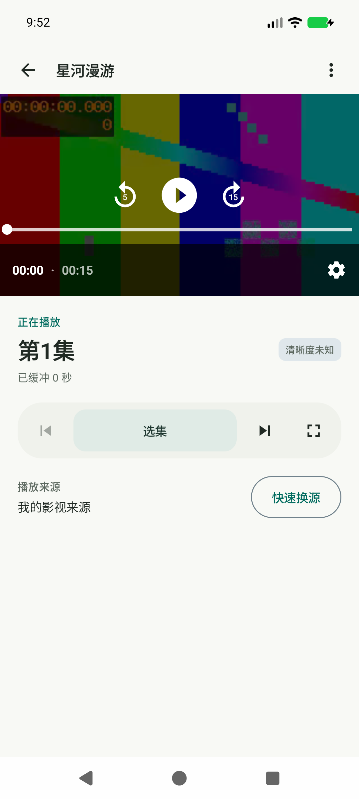
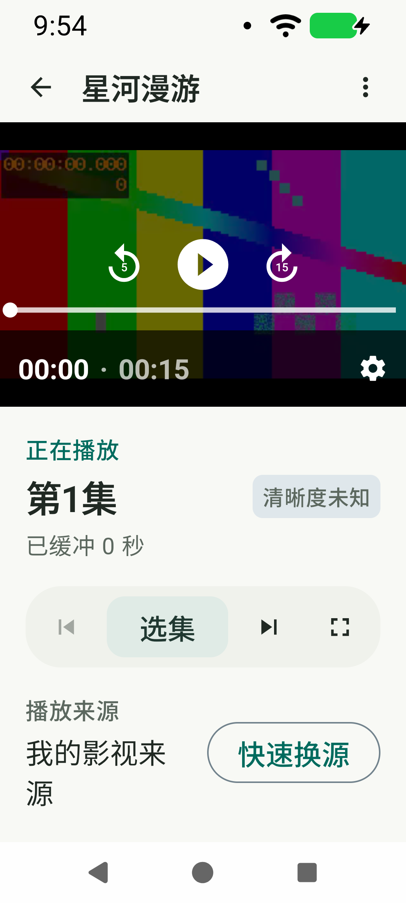
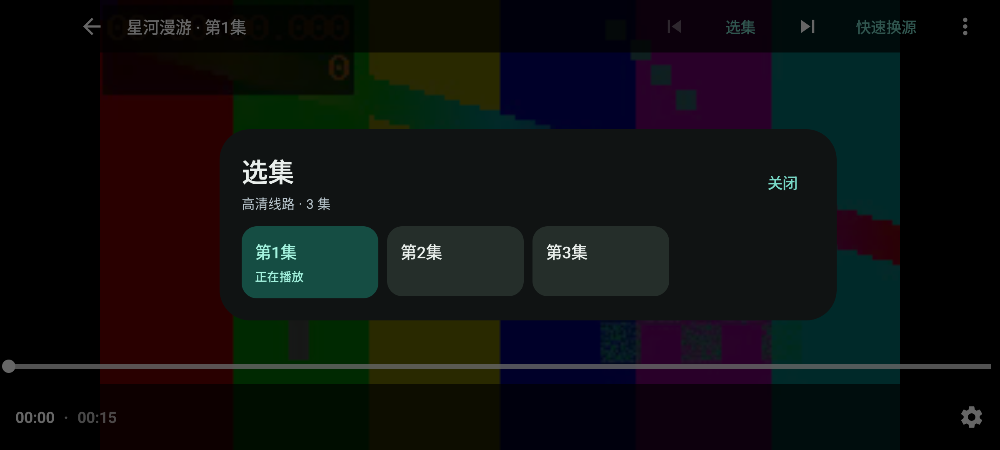
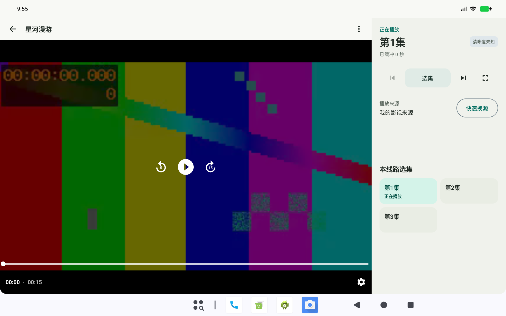

# v0.12.0 · 播放器布局与选集

## 参考判断

[android-media-pack](https://github.com/sunnat629/android-media-pack) 是 Media3 技能指南、示例与开发工具集合，采用 Apache-2.0 许可证。它适合指导播放器组件、自适应布局与生命周期设计，不是可以直接应用的视觉皮肤。

本次阅读并参考了以下指南：

- [View 播放器 UI](https://github.com/sunnat629/android-media-pack/blob/main/.skills/media/ui/media3-view-ui-player/SKILL.md)：保留现有 PlayerView 互操作、生命周期绑定及成熟控制能力。
- [Compose Material 3](https://github.com/sunnat629/android-media-pack/blob/main/.skills/media/ui/media3-compose-ui-material3/SKILL.md)：分离播放器所有权与界面状态，保持视频区域稳定。
- [自适应界面](https://github.com/sunnat629/android-media-pack/blob/main/.skills/media/ui/media3-adaptive-compose-ui/SKILL.md)：不同窗口空间采用不同布局，保证触控区域与安全边距。

指南以 Media3 1.10.1 为目标，本项目保持已有 1.6.1；本次未安装该技能包、复制其源码或引入新依赖。改动集中在展示层，订阅、更新、历史聚合和播放会话逻辑保持原实现。

## 界面改动

- 手机播放页重新组织当前分集、缓冲状态、分集操作与来源信息。常用分集操作放在一条独立操作区，更多设置保留在右上角。
- 视频内仅保留播放/暂停、后退/快进、时间轴和播放设置；移除与页面重复的原生上一集/下一集按钮。
- 选集面板改为自适应网格，标记当前集及无障碍选中状态，打开时定位到当前集。大字体自动减少列数，长列表使用惰性网格。
- 可用窗口至少 840×480dp 时，视频与信息/选集并排显示。全屏和画中画仍使用单一视频区域，布局切换沿用同一播放器所有者。

## 本地验证

本机 Android API 37 模拟器验证：

- 89 项单元测试通过，debug / androidTest / release 编译通过。
- 标准手机、320dp / 150% 字号、1280×800dp 宽屏实际布局与操作通过；夜间主界面回归通过。分集触控目标至少 48dp。
- 500 集滚动、当前集自动定位、首尾集按钮状态、真实触控快进/暂停/拖动、切集与返回通过。
- 宽屏直接选集、点击当前集不重建播放器、进出全屏不重建播放器通过。
- 全屏、画中画、快速换源、缓冲重试、后台恢复通过。压力测试观测到创建/释放均为 56，弱引用残留 0、活动媒体请求 0，最大释放耗时 382ms（含同进程先行用例）。
- 宽屏软件模拟器触发既有解码器回退，调用栈确认额外创建来自 `recoverDecoder`。测试独立核对回退次数和存活实例，切集后活动播放器为 1，退出后全部释放。没有修改解码器或播放生命周期逻辑。
- 应用内更新下载/校验/系统安装入口、历史分集聚合与删除回归通过。
- 发布后从 GitHub 下载正式 APK，SHA-256、包名、版本和原签名校验一致；实际系统安装确认后完成 0.11.0（17）→ 0.12.0（18）升级。首轮公网检查超时、第二轮版本校验拒绝，重新检查后完整链路通过；未绕过校验。
- 正式包 versionName 0.12.0 / versionCode 18，沿用原证书，v2/v3 签名与覆盖安装、冷启动通过。正式 APK 不包含测试媒体、测试安装包或订阅源。

设备专项使用同源码 debug 包；签名正式包单独验证覆盖安装和冷启动。上述是受控模拟器结果，不代表已完成实体手机矩阵或所有条件下的无泄漏保证。

截图均使用本地受控测试视频及虚构条目。
