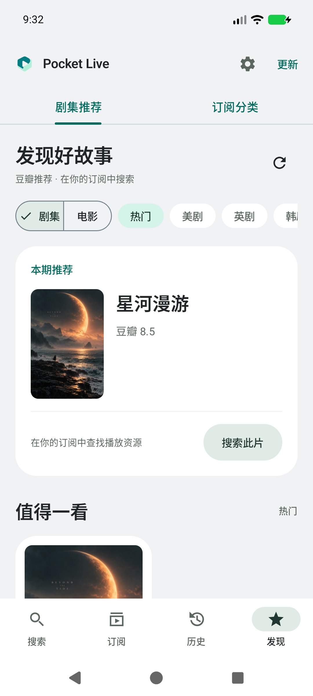
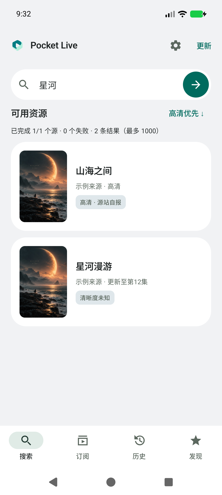
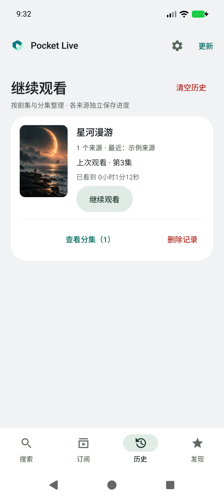
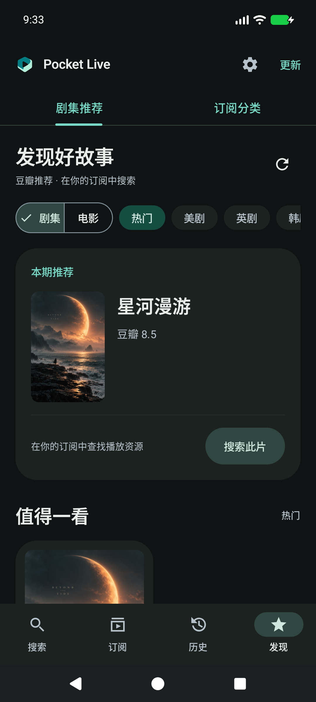
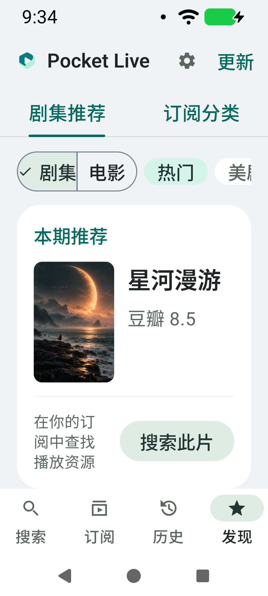
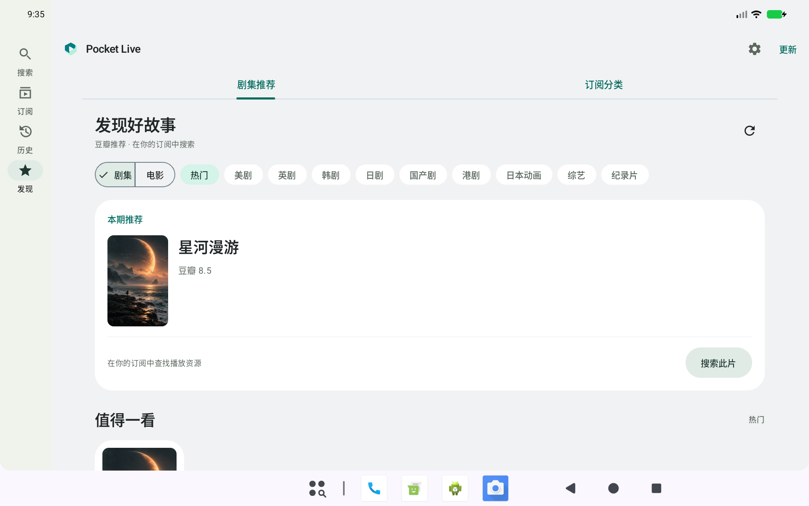

# v0.13.0 · 柔和分组卡片

## 设计依据与范围

参考用户提供的手机设置页截图：浅灰背景、大圆角白色分组、克制的分隔线、明确的文字层次与留白。结合现有媒体封面和青绿品牌色实现原生 Compose 界面，没有复制截图资产或引入模糊、阴影动画和额外图片库。

- **共享样式**：发现、搜索与历史使用同一个 `ContentCard`，28dp 圆角；页面水平边距 20dp，内容行内边距及封面间距 16dp。夜间模式使用相应深色卡片。
- **发现**：重点推荐改为与内容卡片一致的浅色/深色表面，以封面、标题、评分和分隔后的搜索操作组织内容；海报网格也使用相同卡片。来源/分类筛选采用柔和胶囊标签，保留选中状态。
- **搜索**：白色胶囊搜索框，结果改为完整圆角卡片；保留来源、更新说明、清晰度标签、排序与搜索进度。
- **历史**：封面和播放信息组成主区，续播使用柔和强调按钮，分集展开与删除放在细分隔线后的操作区。分集和来源记录使用同一表面样式并保留缩进层级。

推荐来源、搜索排序/取消、历史聚合/断点/删除确认、订阅、播放与更新逻辑均未改变。没有新增异步任务、网络请求或后台常驻对象。

## 验证

本机 API 37 模拟器验证：

- 89 项单元测试全部通过，debug / androidTest / release 构建通过。
- 标准手机日间与夜间、320dp / 150% 字号、1280×800dp 宽屏操作和截图检查通过。
- 推荐类型/分类切换、分页、海报、错误重试、同名搜索、订阅分类搜索通过；大字体下滚动到“搜索此片”并点击，确认正确进入搜索。
- 历史剧集/分集/来源展开、继续观看、独立断点、删除与清空确认通过。
- 1000 条结果完成 30 次滚动；受控本地 HTTP 与 debug 软件模拟器下全部结果到达 1483ms，非公网或真机性能承诺。
- 海报后台恢复、更新下载/取消/校验/真实系统安装入口回归通过。
- 正式签名 APK 的 v2/v3 校验、0.12.0 → 0.13.0 覆盖安装和冷启动通过；versionCode 19，版本号 0.13.0。
- 发布后从 GitHub 实际下载、校验并经系统安装器完成 0.12.0（18）→ 0.13.0（19）升级；下载大小 2652471 字节，SHA-256 与原签名均匹配。
- 正式 APK 资产仅含许可证及基线配置，不包含测试海报、媒体、测试安装包或订阅源。

没有修改播放器、图片请求所有权、存储和线程调度。设备专项使用同源码 debug 包；正式 APK 单独验证覆盖安装及冷启动。未进行实体手机矩阵或完整 TalkBack 审核。

截图使用本地受控测试数据与测试海报，均不进入正式包。
