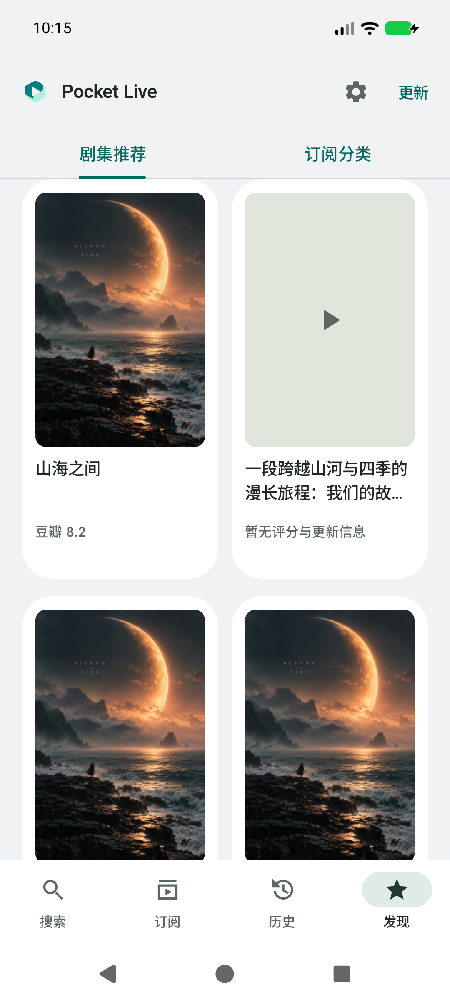
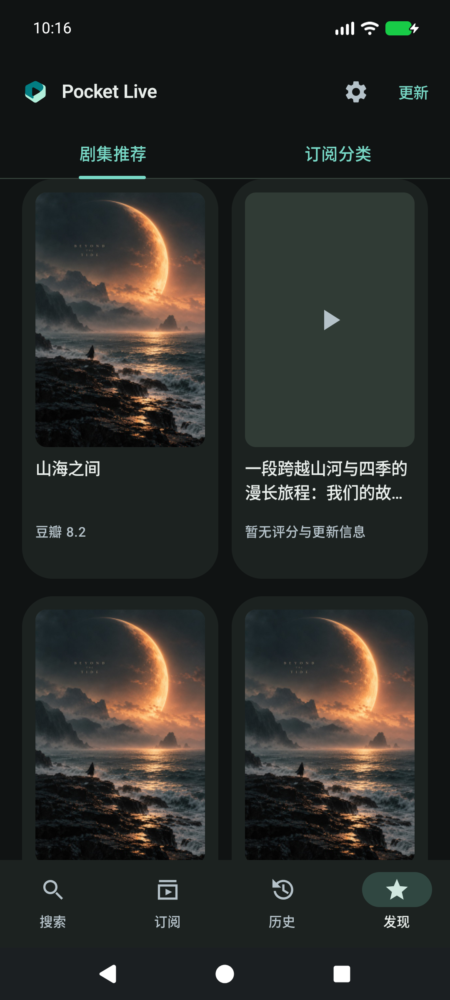
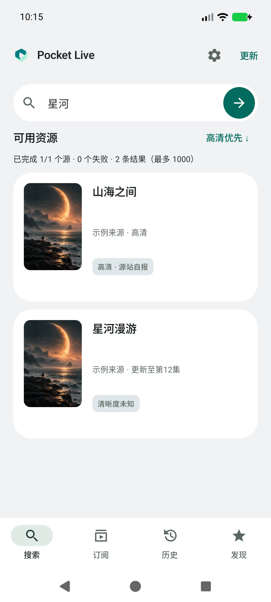
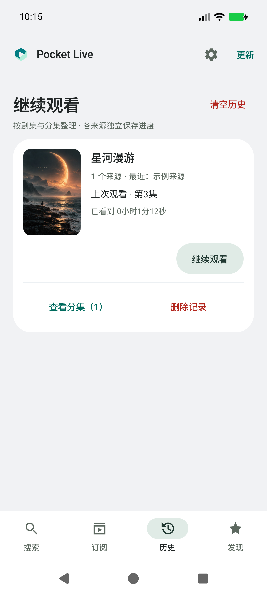
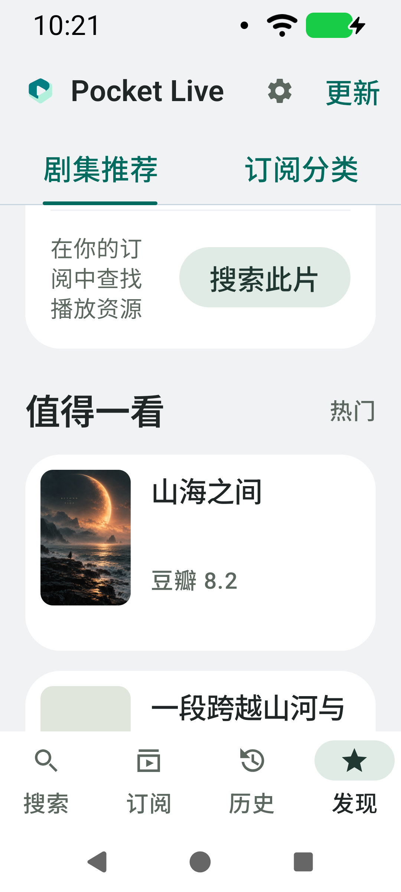
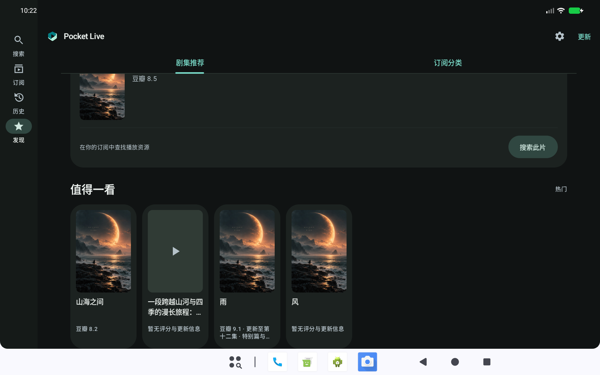

# v0.14.0 · 内容卡片对齐

## 调研与取舍

- [Android 官方 Lazy grids / staggered grids 指南](https://developer.android.com/develop/ui/compose/lists)：规则网格用于行列排布，交错网格允许不同高度的条目；应为异步内容预留尺寸，避免加载后布局变化，并使用稳定 key 与内容类型。
- [Pinterest Gestalt Masonry 实现](https://github.com/pinterest/gestalt/blob/master/packages/gestalt/src/Masonry.tsx)：参考其固定列宽、间距及虚拟化的处理原则，不引入 Web 库或复制实现。

本次目标是消除评分有无、标题换行导致的卡片参差。影视封面已统一为 2:3，采用固定文本槽位的规则网格可以保持封面、标题、说明和卡片底边对齐；自由高度瀑布流会刻意错开各列底边，不适合这个目标。保留现有推荐顺序和惰性加载。

## 对齐规则

- 推荐网格：海报固定 2:3；标题固定预留两行、最多两行；评分/更新说明区固定预留两行、最多两行。文本过长使用省略号，点击仍以完整片名搜索。
- 大字体单列推荐使用左侧 72×108dp 封面与右侧文字，避免单张海报占满屏幕。多列仍使用竖向 2:3 海报卡片。
- 说明完全缺失时显示“暂无评分与更新信息”，不编造评分。缺封面继续使用等尺寸占位。
- 搜索和订阅分类结果：封面统一 88×132dp，封面与文字顶部对齐；标题与来源/更新信息各预留两行。搜索清晰度区预留统一高度，标签本身保持紧凑。
- 历史：封面与正文顶部对齐；续播使用独立靠右操作区，分集和删除按钮平分操作行；剧集、分集、来源使用逐级缩进。
- 沿用 20dp 页面边距、16dp 行内间距与既有圆角；不修改播放、订阅、搜索排序或历史聚合逻辑。未新增后台任务或请求。

## 验证

本机 Android API 37 模拟器验证：

- 89 项单元测试通过，debug / androidTest / release 构建成功。
- 新增混合推荐数据：短标题、跨两行的长标题、无评分、长更新说明、缺封面。逐张检查卡片高度、标题槽位起点和说明槽位起点，误差不超过 1dp；标准手机、夜间、大字体单列与宽屏通过。
- 初次只设置文本最小行数时，上述测试捕获约 3.4dp 的高度差；改为随字号缩放的独立槽位后通过。保留自动化几何断言，避免以后仅凭短标题截图判断。
- 320dp / 150% 字号、1280×800dp 宽屏操作及截图检查通过；大字体单列采用横向卡片，推荐搜索按钮仍能滚动到并正常点击。
- 推荐类型/分类/分页、失败重试、同名搜索、订阅分类搜索、历史分集/来源展开、续播、删除和清空通过。
- 1000 条搜索结果完成 30 次滚动；受控 HTTP、debug 软件模拟器全部结果到达 615ms，不代表公网或实体设备性能。
- 更新下载/校验/系统安装入口回归通过。正式包沿用原证书，v2/v3 校验、覆盖安装及冷启动通过，versionCode 20 / versionName 0.14.0。
- 正式 APK 不含订阅源、测试媒体、海报或测试安装包。测试数据只在 androidTest 与文档截图中使用。

未修改播放器或请求生命周期；本轮重点验证布局与既有行为，没有新增后台任务。设备专项使用同源码 debug 包，正式包单独做覆盖安装与冷启动。未覆盖实体手机矩阵及完整 TalkBack 审核。

