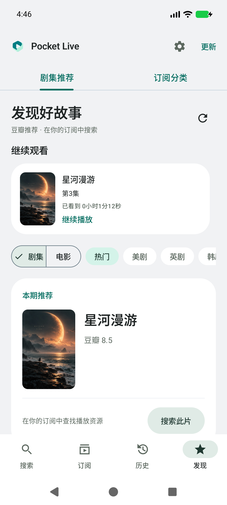
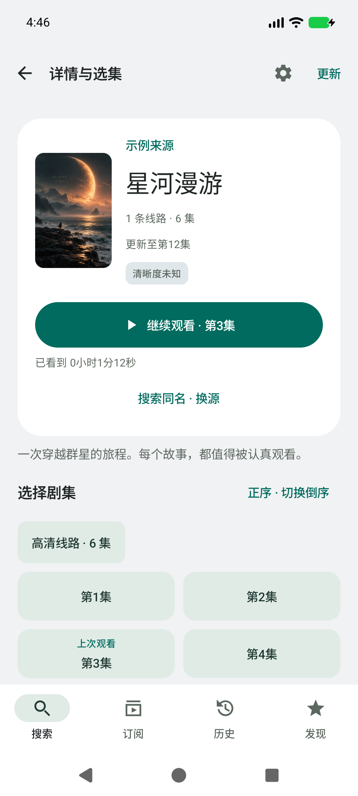
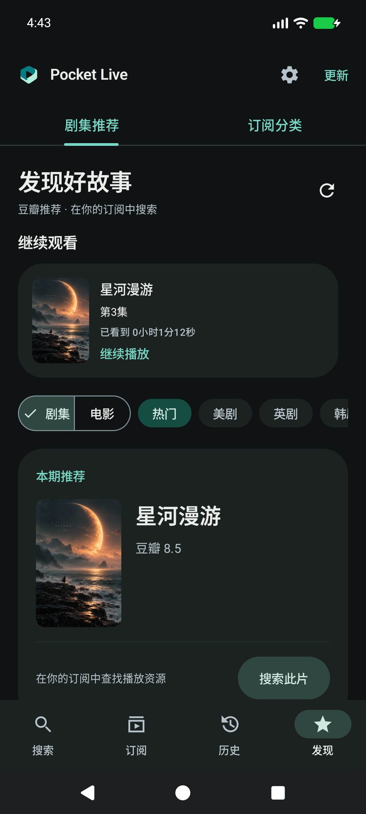
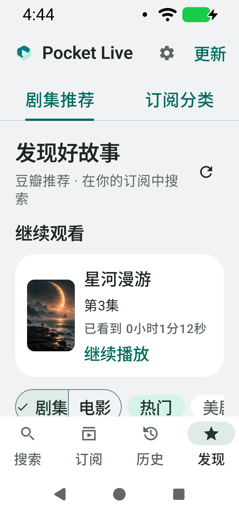
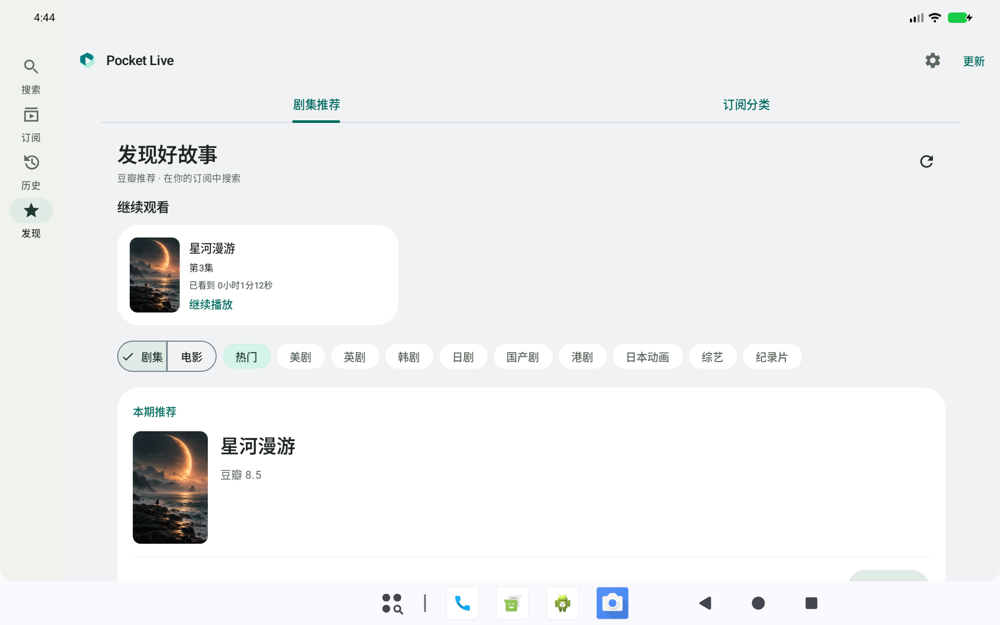

# v0.17.0 · 发现与续播

## 参考与取舍

参考 Android Gallery 的[媒体探索](https://developer.android.google.cn/design/ui/gallery/media/discovery?hl=zh_cn)与[媒体详细信息和播放](https://developer.android.google.cn/design/ui/gallery/media/detail?hl=zh_cn)：用内容信息流帮助浏览，突出媒体及主播放操作，并利用宽屏空间将相关信息并排呈现。

沿用已有青绿配色、浅色/深色主题、规则海报网格及宽屏导航，不复制示例影片、海报或商业服务资产。

## 界面与交互

- 发现页加入最多五部最近观看内容的横向卡片，显示封面、影片、集数与实际断点，点击直接续播。沿用既有历史合并及直播从实时位置打开的规则，不增加持久化数据或后台请求。
- 详情以一张内容卡片整合封面、来源、标题和主播放按钮。宽度充足时采用封面与文字并排，大字体回到纵向结构；简介与选集继续使用可滚动内容。
- 主按钮优先继续最近观看的一集，并默认选中对应线路。必须同时匹配来源、影片 ID 与仍存在的播放地址，不按同名或列表序号猜测。切换其他线路后，按钮使用该线路第一集，避免操作与选中线路不一致。
- 选集支持正序/倒序，当前线路最近观看集显示“上次观看”。切换顺序仅改变呈现顺序，不修改来源返回内容或播放地址。
- 发现页的推荐/订阅分类选择与分类搜索输入可随 Activity 状态恢复。原有推荐分页、刷新、搜索与订阅导入保留。

## 验证

- 95 项单元测试通过，包括续播的来源/影片 ID/可用地址隔离、最新记录选择，以及当前集名更新时保留断点。
- debug、androidTest、release 构建与 release lint 检查通过。
- API 37 模拟器的标准手机、夜间、320dp / 150% 字号、1280×800dp 宽屏布局回归通过；检查推荐卡片对齐、主操作可达、500 集倒序/线路切换、简介展开与同名搜索。
- 发现页续播集成断言确认恢复 72 秒断点；已有搜索、订阅设置与历史入口继续通过。
- 截图检查后压缩详情头部，保证标准手机在主播放区下能更早看到选集；还发现合成历史的旧集名与当前来源集名不同，增加规则测试并修正为使用当前元数据。
- 最终 4 项设备回归通过（界面、500 集选集、更新下载/校验/权限/安装入口和取消失败清理）；正式包完成 0.16.0（22）→ 0.17.0（23）覆盖安装及冷启动。
- 签名采用与 v0.16.0 相同的正式证书，v2/v3 校验通过；正式包仅含许可证及编译基线，不含测试媒体、测试安装包或私钥。

设备专项使用同源码 debug 包；未覆盖实体手机矩阵或完整 TalkBack 审核。

