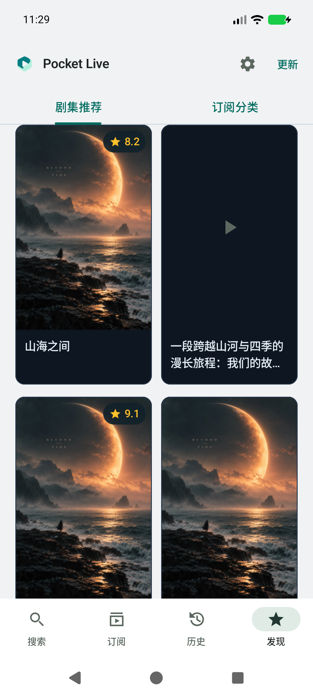
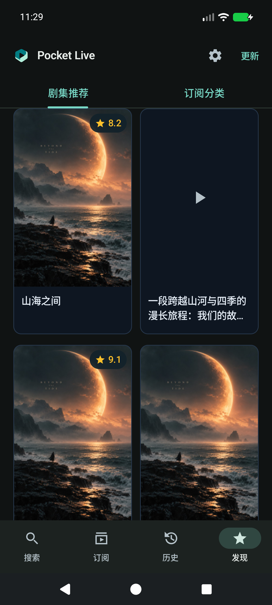
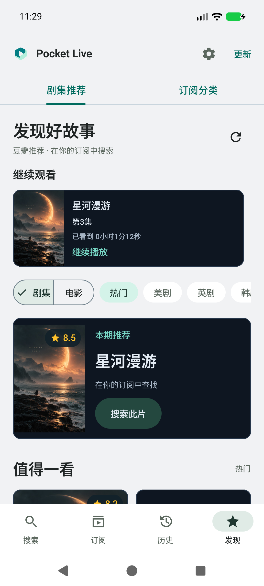
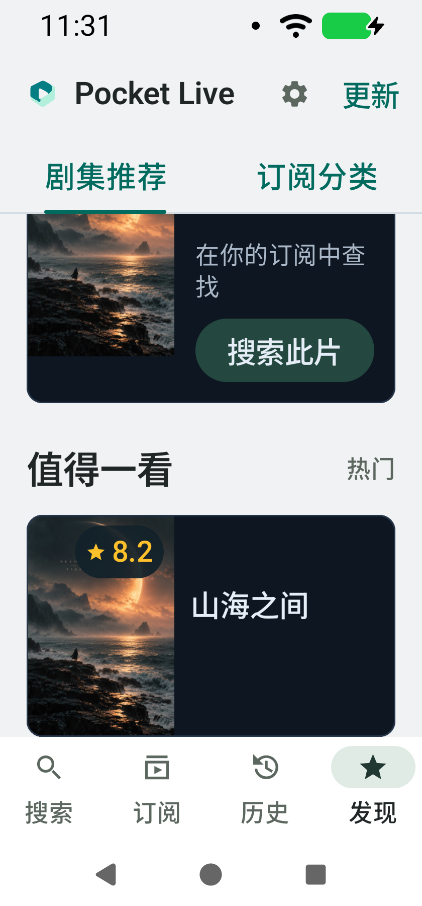
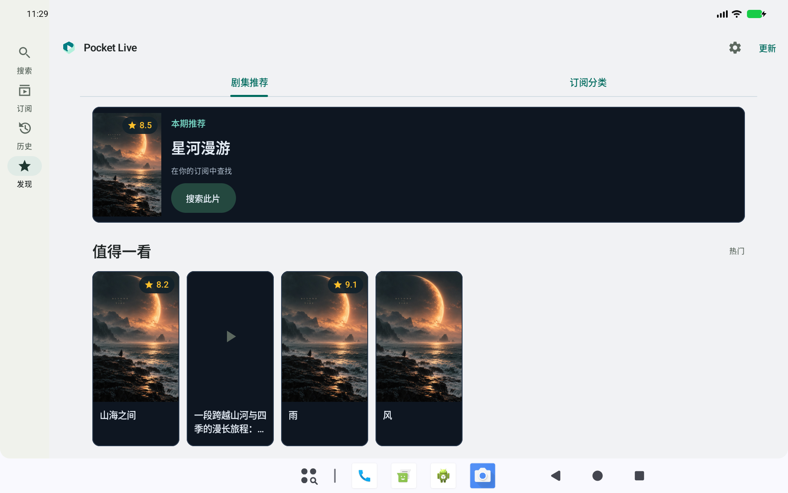

# v0.18.0 · 贴边海报卡片

参考用户提供的卡片截图，实现海报贴边、深色标题栏、细描边、圆角外轮廓与右上角金色评分胶囊。未复制参考图中的电影海报。

推荐网格海报保持 2:3，取消 12dp 内边距与海报独立圆角，由卡片统一裁切。大字体单列继续采用左侧 112×168dp 海报与右侧文字，避免海报占满屏幕。标题保留两行固定槽位，长短标题和缺评分不影响卡片对齐。评分来自推荐返回的真实豆瓣评分，没有评分时不编造数据，也不显示空胶囊。网格不再重复展示底部评分说明；卡片点击仍以完整片名搜索。

发现页本期推荐、继续观看及订阅分类使用相同深色表面与高对比文字；日间与夜间均保留此卡片风格，页面其余主题与导航不变。沿用原有海报缓存、解码上限、加载生命周期和点击行为。

## 验证

- 95 项单元测试通过，debug / androidTest / release 构建及 release lint 检查通过。
- API 37 模拟器验证标准手机、夜间、320dp / 150% 字号、1280×800dp 宽屏；截图检查与几何断言覆盖海报贴边、卡片高度/标题对齐、缺海报和缺评分。大字体单列保留横向紧凑布局。
- 既有搜索、详情、订阅设置、历史、推荐刷新、点击搜索与 72 秒断点续播回归通过。
- 模拟器完成 v0.17.0（23）→ v0.18.0（24）覆盖安装；最终签名包再次覆盖安装及冷启动正常。
- 正式签名沿用旧证书，APK v2/v3 签名验证通过。正式包未包含测试媒体、测试安装包、参考海报或私钥。

以上为模拟器验证，未覆盖实体手机矩阵或完整 TalkBack 审核。

