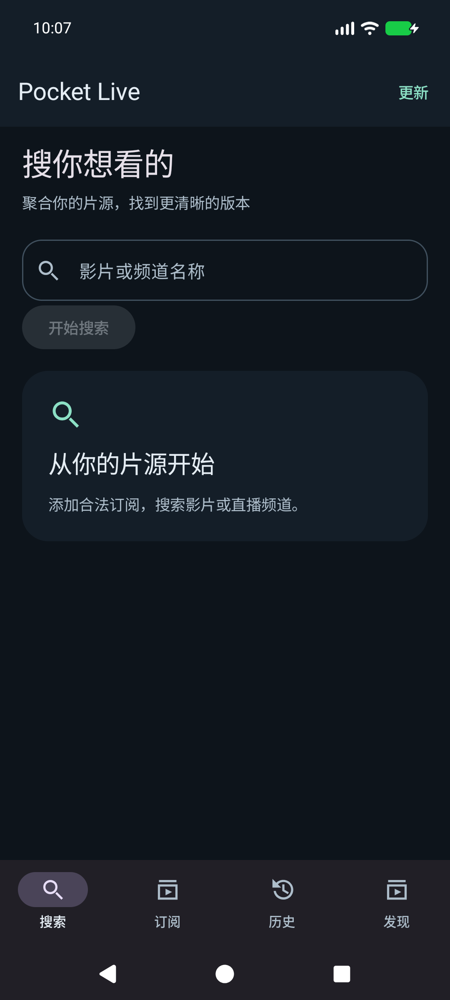
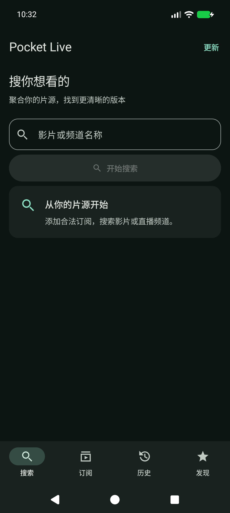
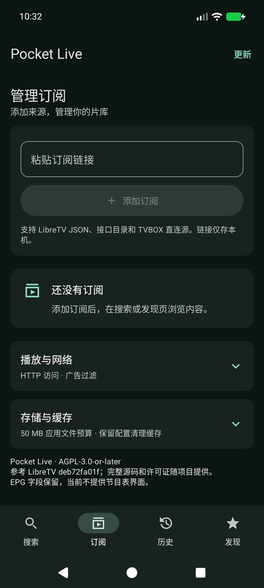
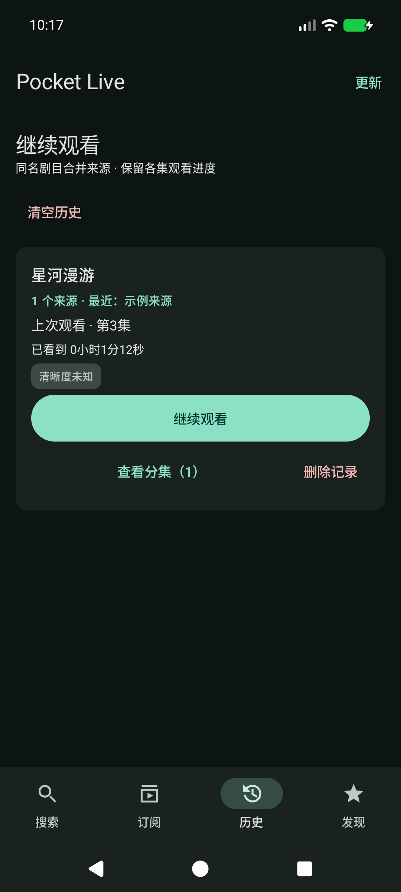
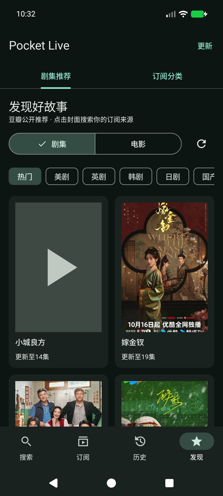
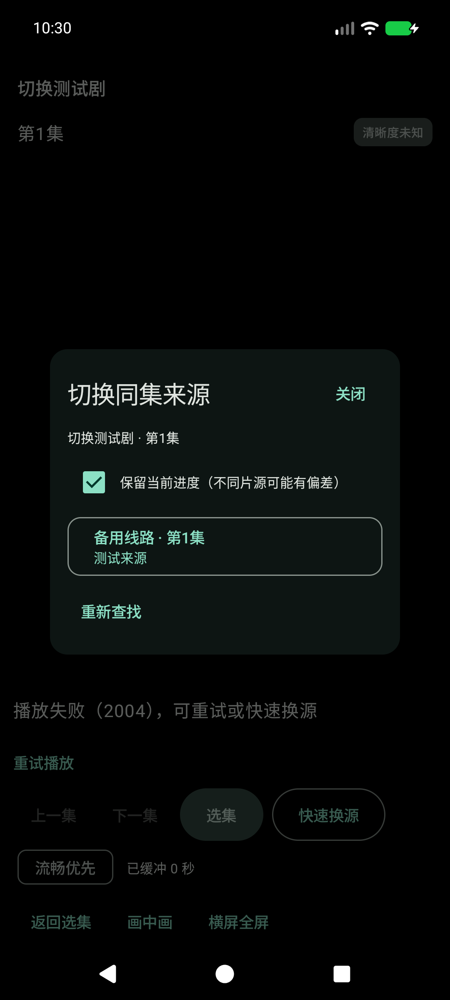
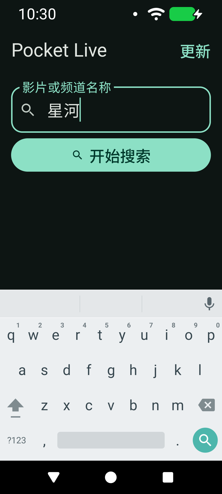

# v0.6.0 UI 调整与验证

本次只调整 Compose 界面、按钮呈现、排版、滚动和主题。点播/直播、订阅解析、历史合并、推荐恢复、更新检测、50 MB 预算和播放策略保留原实现。

## 设计依据

- [Android Material 组件](https://developer.android.com/design/ui/mobile/guides/components/material-overview)：使用操作优先级、容器、导航、标签页与分段按钮区分任务。
- [Compose 无障碍默认行为](https://developer.android.com/develop/ui/compose/accessibility/api-defaults)：关键操作至少 48dp，开关整行可点击，图标操作有朗读名称。

## 页面检查

1. **搜索：通过。** 主搜索按钮统一为填充样式，结果卡片使用同一表面色；键盘出现时收起说明区域，键盘搜索键与按钮调用同一已有搜索操作。
2. **订阅：通过。** 添加订阅集中在一张卡片；低频的播放/网络和存储选项分组折叠。删除使用错误色，开关右置并支持点击整行。日期使用较短系统格式。
3. **历史：通过。** 继续观看是主要操作，分集与删除保持次级，跨源合并和各集断点逻辑未改动。
4. **发现：通过。** 推荐/订阅分类使用标准标签页；剧集/电影使用分段按钮，刷新为带无障碍名称的图标按钮。海报和数据接口不变。
5. **播放：通过。** 选集与换源有明确按钮层级，辅助操作可换行；小屏/横屏操作区和换源内容可滚动，媒体视图与播放器控制器保持原实现。

## 边界与可访问性

统一为青绿色 Material 3 暗色角色，补齐 container 等颜色，去掉默认紫色与原主题混用。主要界面边距 16dp、间距以 8dp 为基准，保留系统字体缩放。

测试覆盖标准宽度和 320dp / 150% 字号，实际检查搜索键盘、设置展开、缓存入口、历史继续和发现刷新。关键按钮测量至少 48dp。正文/背景、次级文字/卡片、主按钮文字/背景的计算对比度分别约 14.51、9.57、8.49。

这不等于 Google 官方认证，也不代替全机型或完整 TalkBack 审核。截图中的示例来源和测试片名属于本地测试数据，不打包为订阅源。

## 底层保持不变

对比 v0.5.0：AppModel、Network、Storage、HistoryGroups、PlaybackController、PlaybackPolicy、MediaCallOwner、PosterStore、Parsing、AutoHls 内容未变化。AppUpdates 的解析与版本检测部分未变化，仅弹窗内容增加滚动。

## 本地验证结果

- 83 项 JVM 单元测试通过；13 项设备测试运行通过（包含标准尺寸与 320dp / 150% 字号的两次 UI 测试）。
- 回归覆盖推荐恢复、海报、历史合并、更新检测、快速换源、播放器释放，以及横屏 500 集选集与返回键。
- 播放器压力测试创建/释放均为 50 次，剩余弱引用 0，活动媒体请求 0，最大释放耗时 63ms；阶段采样 PSS 为 143296、144322、144266、143604 KiB。本轮未观察到持续增长或死锁，不构成所有运行环境的绝对保证。
- Release APK 使用原证书签名，v2/v3 签名验证通过，覆盖安装确认 versionName 0.6.0 / versionCode 12。
- 正式包实际加载了推荐与海报；部分封面不可用时保留占位图。测试环境为本机 Android API 37 模拟器。

## 截图记录

搜索改版前后（同为空白订阅状态）：

| v0.5.0 | v0.6.0 |
| --- | --- |
|  |  |

按使用流程查看：

1. 搜索：主操作和空状态分层。
2. 订阅：添加入口与低频设置分组。
3. 历史：继续观看、查看分集、删除区分层级。
4. 发现：标签页、类型切换、刷新与海报列表。
5. 播放：换源弹窗保留进度选项与备用线路。

 

 

320dp / 150% 字号与键盘同时显示：

