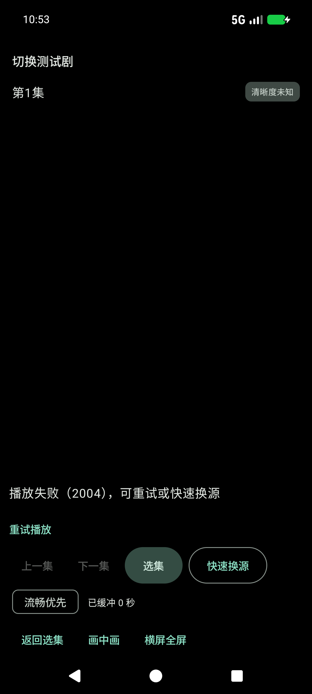
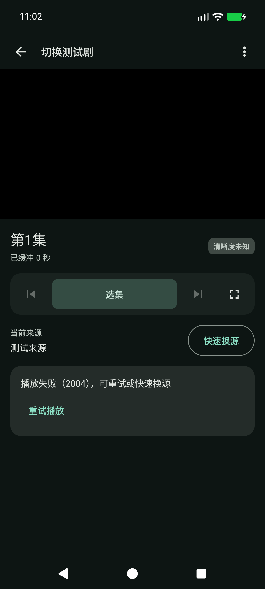
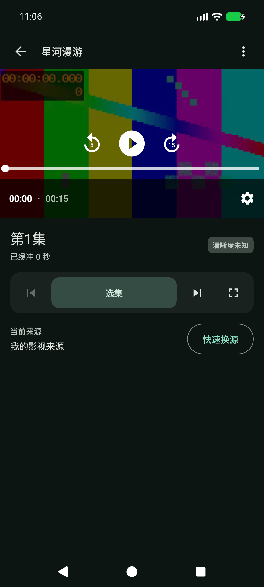
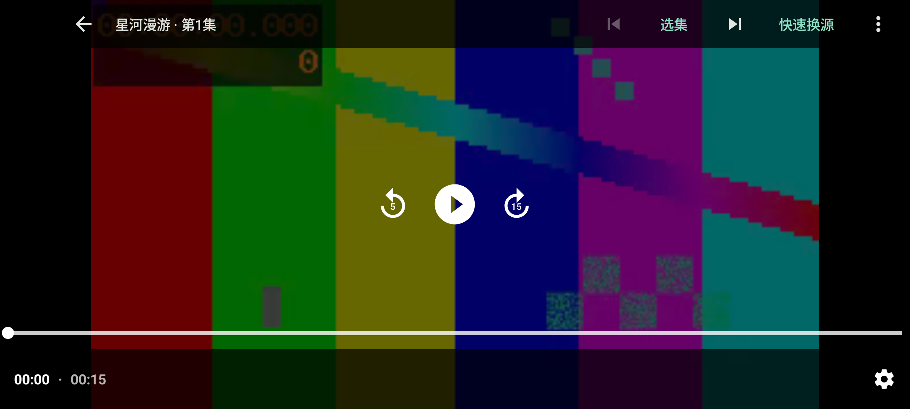
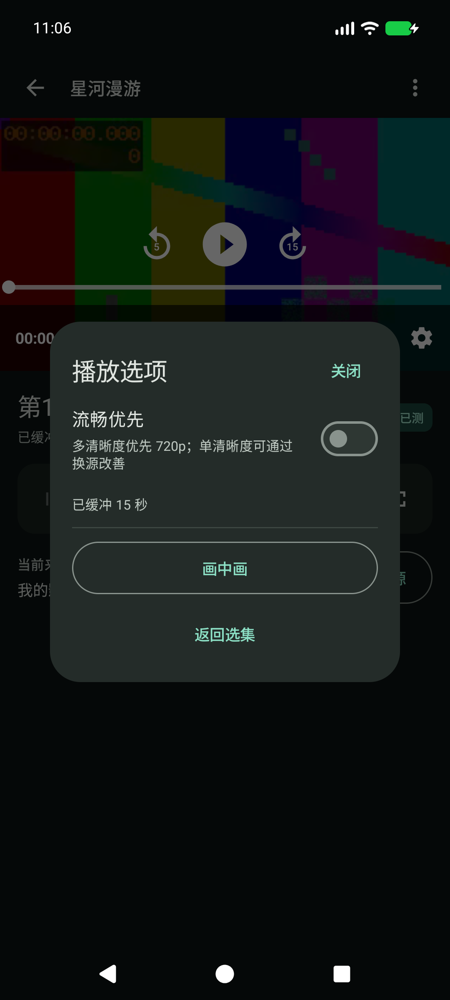
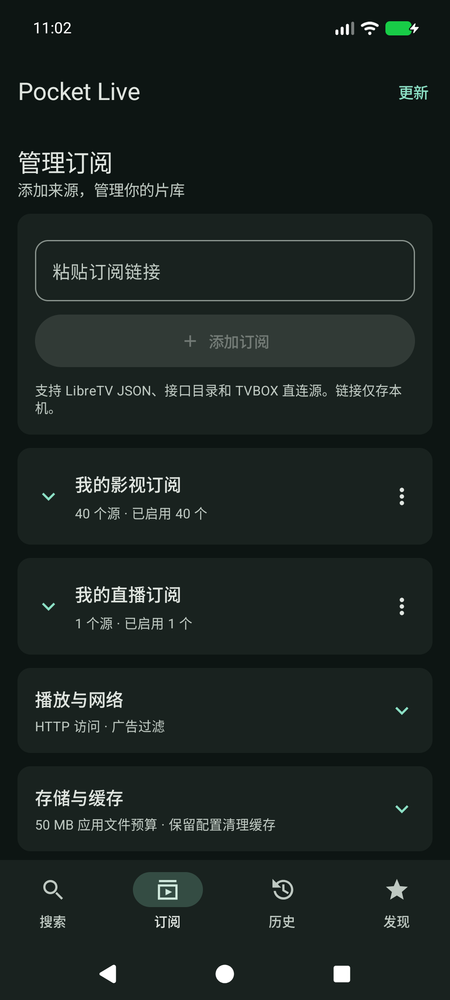
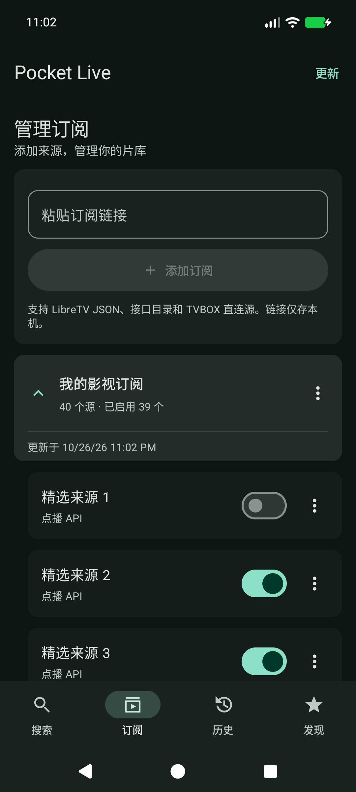
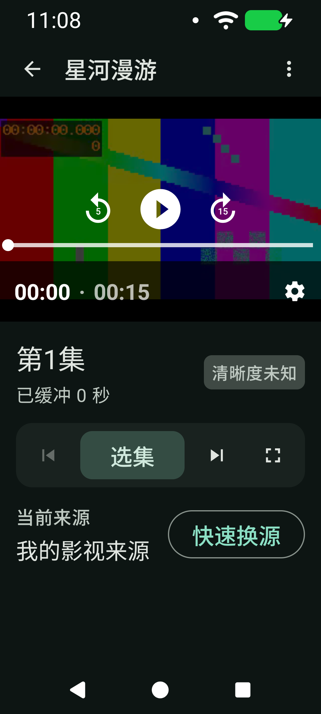

# v0.7.0 播放器与订阅界面

本次调整界面和操作入口。播放控制器、网络、解析、缓存、广告过滤和数据模型未变；不内置任何播放源。

## 参考与改动

参考 [VLC Android 的播放器分区与 More Options](https://docs.videolan.me/vlc-user/android/3.X/en/video/video_player.html)，采用常用操作直接显示、低频选项进入菜单的方式。沿用 Android Material 3 与 Media3 原生控制器，未复制 VLC 的资源或代码。

1. **竖屏播放**：旧版视频区高度过大，底部混排多组文字按钮。现在顶部为返回、片名、更多；视频下方是一条选集工具栏，以及独立的来源和快速换源区域。正常宽度按 16:9 显示，小宽度保留原生时间栏所需高度，视频仍按比例适配。
2. **横屏播放**：顶部只显示一条工具栏，中央播放与底部进度继续由 Media3 管理；控制层隐藏后工具栏同步隐藏。失败或持续缓冲时，恢复操作保持可达。
3. **播放选项**：流畅优先、缓冲和广告信息与画中画收进“更多播放选项”。设置变化与横竖屏切换不应重建播放器。
4. **订阅摘要**：默认收起来源，显示总数与启用数。点击卡片展开，切换另一订阅时收起前一个；更新和删除放在订阅菜单，删除仍需确认。
5. **来源管理**：展开后仍为惰性列表，保留来源启停；精确广告路径进入该来源的菜单。收起只改变显示状态，不改变启用状态或订阅数据。

## 验证范围

在本机 Android API 37 模拟器上测试标准宽度、320dp / 150% 字号与横屏。主要图标按钮和选集操作至少 48dp，图标有操作名称。测试视频与订阅均为测试代码中的合成夹具，不进入正式 APK。截图不能代替完整 TalkBack 审核或全部机型兼容性验证。

## 验证结果

- 83 项单元测试通过。13 次专项与回归测试通过，标准尺寸和大字号分别计数，不包含开发中的重复运行。
- 播放器布局：正常解码、原生时间和设置入口、48dp 操作、横竖屏不重建播放器、选集切换与退出。
- 订阅分组：40 个来源展开/收起、滚动末项、启用状态保留、保存状态恢复、切换分组、更新、删除确认、来源规则菜单；标准与大字号各验证一次。
- 播放回归：快速换源、慢源提示、多码率选择、暂时失败重试、500 集选集、原生播放按钮/进度条、返回键、换集后长按清理。
- 画中画：从更多菜单进入、系统展开返回、保留同一播放器及暂停进度；全屏错误状态与未初始化播放器的重试入口可用。
- 资源压力：压力测试结束时累计创建与释放均为 54，活动媒体请求为 0，追踪的播放器弱引用剩余为 0；最长释放 150ms。阶段 PSS 为 142868、141660、141382、142592 KiB，本轮未观察到持续增长或死锁。有限测试不能证明所有环境绝无泄漏或死锁。
- Release APK 沿用原证书，v2/v3 签名验证通过；覆盖安装确认 versionName 0.7.0、versionCode 13，冷启动成功。上述专项测试使用对应源码的 debug 测试包。

## 截图与流程检查

1. **竖屏播放：通过。** 原生传输控制留在视频内，选集和来源操作在下方。以下失败状态使用同一测试内容比较改版前后。

| v0.6.0 | v0.7.0 |
| --- | --- |
|  |  |

正常播放：

2. **横屏播放：通过。** 顶部单行工具栏没有遮住中央控制和底部进度条。

3. **播放选项：通过。** 低频选项集中显示；弹窗内容支持滚动。

4. **订阅摘要：通过。** 收起后可同时查看多个订阅，管理菜单独立于展开操作。

5. **来源管理：通过。** 子项有缩进与独立开关，规则入口位于各自菜单。

小屏与 150% 字号下仍显示原生时间、设置和主要操作：

