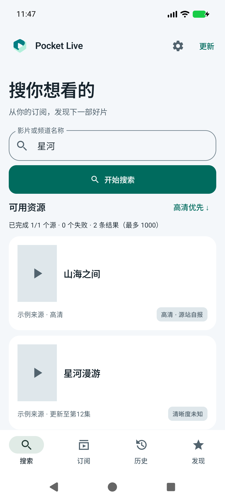
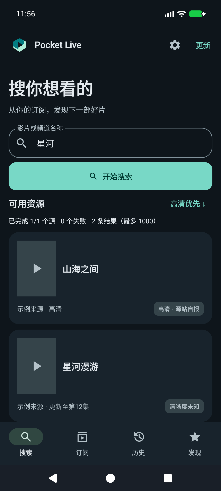
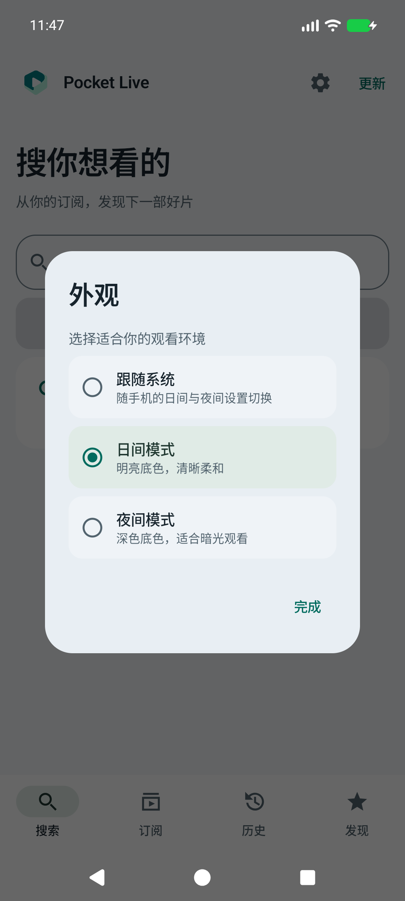
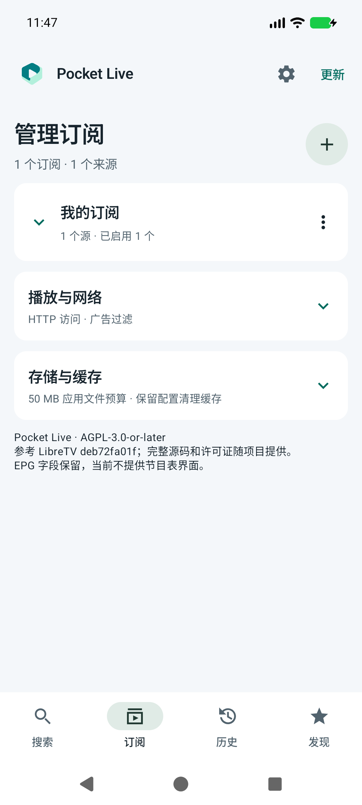
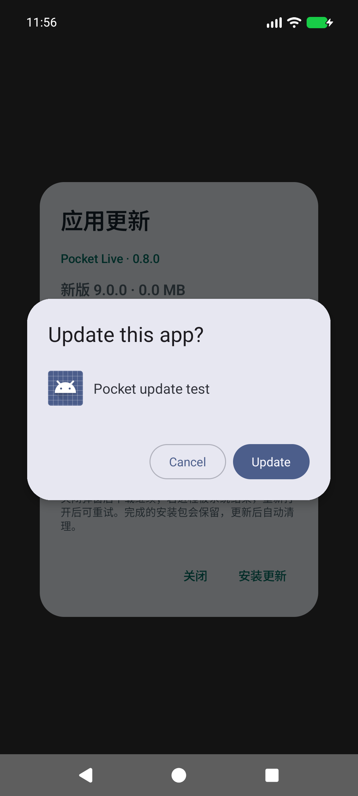
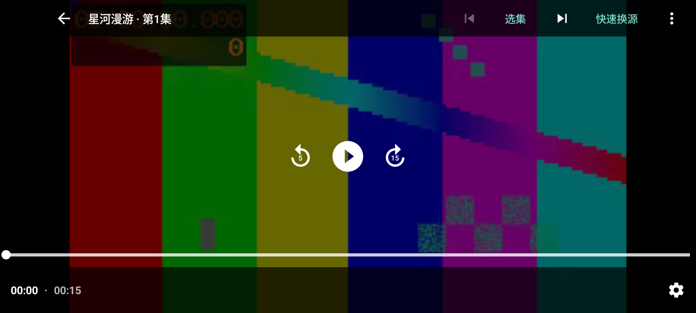
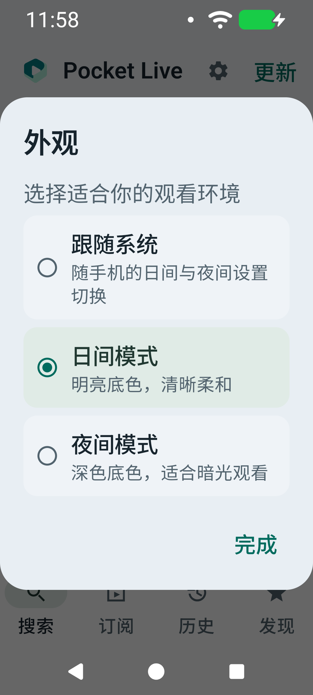
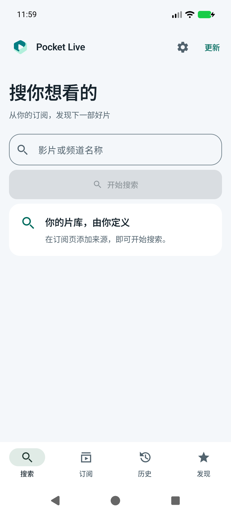

# v0.8.0 外观与应用内更新

使用 Product Design 的截图审查流程，结合 [Android Material 3](https://developer.android.com/develop/ui/compose/designsystems/material3) 原则改进现有原生 Compose 界面。目标是清晰的层级、统一的青绿强调色、适度留白和日夜一致的操作结构。播放、来源解析和广告过滤沿用现有实现；不内置订阅或播放地址。

## 主要变化

1. **搜索与导航**：新增品牌标识，标题和主要操作明确分层；白色卡片与浅灰背景区分内容，夜间使用深蓝灰背景。右上角齿轮进入外观设置。
2. **主题选择**：跟随系统、日间、夜间三种模式即时生效并持久化。选择项带单选语义，弹窗可滚动；偏好监听随组合退出注销。全屏与画中画保持深色播放器控件。
3. **订阅管理**：有订阅时收起添加表单，通过加号展开；保留原有来源展开/收起、启停和管理菜单。
4. **应用内更新**：下载进度、取消、失败重试、安装权限引导、系统安装确认都从应用内触发。已完成的安装包恢复后重新验证，文件被更改时转为可重新下载状态。
5. **Logo**：口袋折面与播放负形，应用内标识与 Android adaptive icon 共用。原图、生成工具和提示词见 [品牌文件](brand/README.md)。

## 更新实现边界

只接受本仓库正式 Release 对应 APK；检查 GitHub SHA-256、文件长度、包名、递增版本和既有签名。下载使用 32 KiB 缓冲、单任务及可取消请求，安装文件通过非导出的 FileProvider 临时授权读取。单个更新包上限 12 MB，下载前检查应用文件 50 MB 预算与可用空间。

关闭弹窗可继续下载，系统结束进程后不保证继续；未完成任务需要重试，已完成文件恢复后仍可安装。没有断点续传或静默安装。Android 首次需要用户授予安装未知应用权限，最终安装仍由系统确认。测试夹具 APK 只在 androidTest 中，不进入正式包。

## 截图与流程检查

以下为本机 API 37 模拟器实拍，片名、海报占位与来源为测试夹具。

1. **搜索日夜布局：通过。** 相同操作结构，颜色随主题变化；主要按钮和文字均可辨识。

| 日间 | 夜间 |
| --- | --- |
|  |  |

2. **主题选择：通过。** 当前选项明确，三个选项即时应用，关闭重开仍保留选择。

3. **订阅摘要：通过。** 添加入口与管理卡片分开，来源展开逻辑保持不变。

4. **更新安装：通过。** 完成校验后直接打开 Android 安装确认，无浏览器跳转。下图为本地签名测试夹具的真实系统弹窗，测试取消安装，不替换正式应用。

5. **横屏播放：通过。** 视频内操作保持深色高对比，横竖屏和选项修改不创建额外播放器。

## 验证范围

86 项单元测试通过；标准和 320dp / 150% 字号专项及回归共 18 次通过（不同尺寸分别计数，不含开发中的重复运行）。专项设备测试覆盖更新下载、取消、校验失败、进程对象重建后的文件恢复、权限拒绝后重试、安装 URI 和实际系统确认页；主题切换、搜索/发现/历史/订阅布局、横竖屏播放器、快速换源和持续缓冲恢复均验证。

资源压力测试累计创建与释放播放器均为 58，结束时活动媒体请求为 0，追踪的播放器弱引用剩余为 0，最长释放 290 ms。四阶段 PSS 为 154684、152286、152548、152572 KiB，本轮未观察到持续增长或死锁。有限测试不能证明所有设备和网络条件下绝无泄漏或死锁。

画中画验证通过：进入、系统展开返回、暂停进度及同一播放器保持。Release APK 沿用原签名，v2/v3 验证通过；覆盖安装确认 versionName 0.8.0、versionCode 14，冷启动成功。

截图与设备测试不代替完整 TalkBack 审核、全部 Android 版本或厂商安装器兼容性验证。

320dp / 150% 字号主题弹窗和正式包冷启动：

| 大字号主题选择 | 正式版空库首页 |
| --- | --- |
|  |  |
