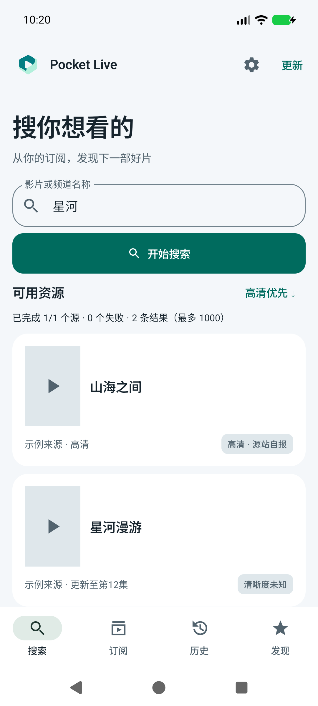
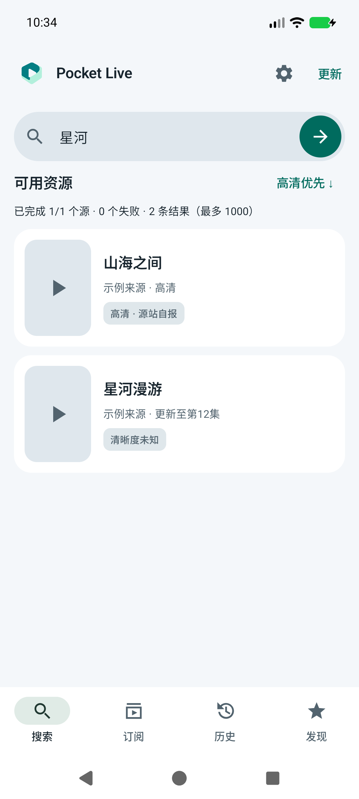
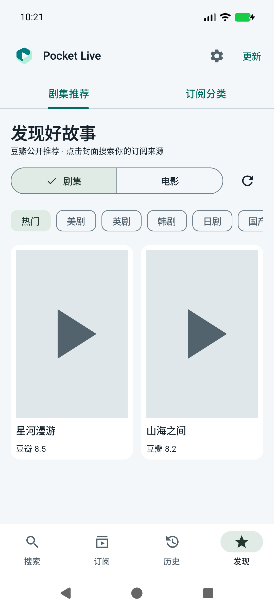
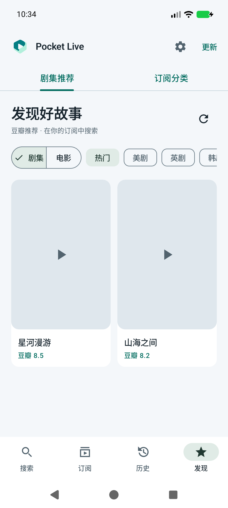
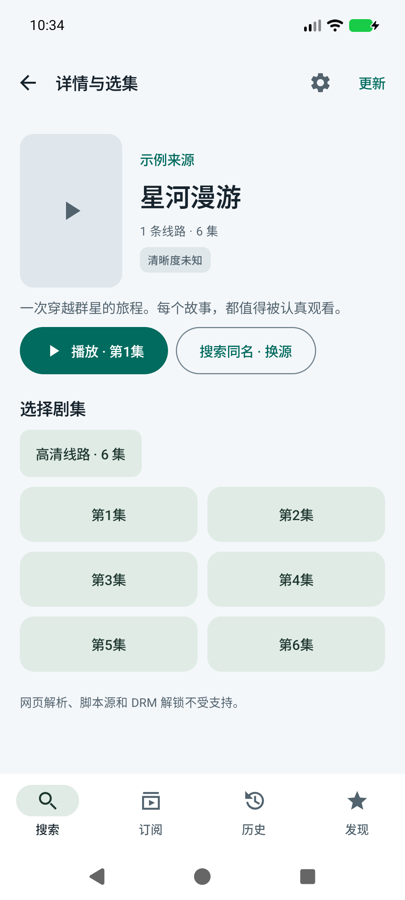
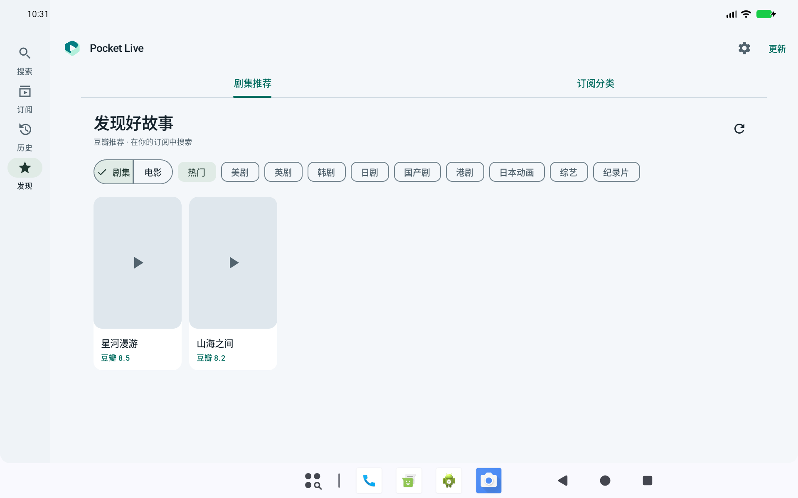
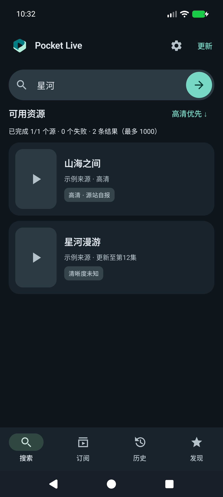
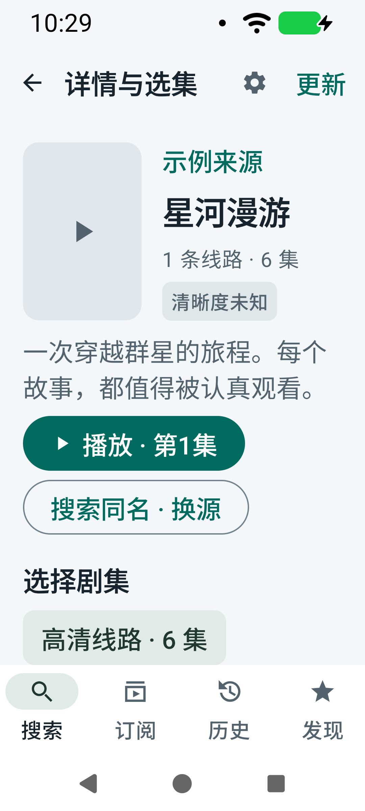

# v0.9.0 · Android Gallery 界面优化

参考用户指定的 [Android UI Gallery](https://developer.android.google.cn/design/ui/gallery?hl=zh-cn)，重点查看了 [媒体探索](https://developer.android.google.cn/design/ui/gallery/media/discovery?hl=zh-cn) 和 [媒体详细信息和播放](https://developer.android.google.cn/design/ui/gallery/media/detail?hl=zh-cn)。采用其内容优先、辅助操作分层、按可用宽度组织媒体信息的思路，适配 Pocket Live 现有 Compose 界面，没有复制示例资源或增加示例播放源。

使用 Product Design 的截图检查流程。改版前后截图均在本轮从本机模拟器重新捕获；来源、片名和媒体为测试夹具，灰色图为封面缺失状态，不代表内置内容库。

## 逐项检查

1. **搜索结果**：移除有结果时的大标题，将提交操作放入搜索栏，结果改为封面、标题、来源和清晰度并排呈现。手机使用单列，宽屏按空间增加列数。键盘搜索和按钮搜索继续调用同一逻辑；提交图标有“开始搜索”的可访问名称，触控区域为 48dp。

| 改版前 | 改版后 |
| --- | --- |
|  |  |

2. **推荐发现**：合并电影/剧集与分类筛选所在行，保留横向滚动；减少封面外的装饰边距，评分与标题层级分明。使用惰性自适应网格，大字号时增加每个项目所需宽度。

| 改版前 | 改版后 |
| --- | --- |
|  |  |

3. **详情与选集**：封面与概要并列，明确播放首集入口；长简介可展开，短简介没有冗余按钮。线路通过筛选项切换，分集采用惰性网格，保留已知清晰度信息和同名换源入口。大字体下按钮换行并保持间距。

4. **宽屏导航**：窗口宽度至少 600dp、可用配置高度至少 480dp 时使用侧边导航，其余使用底部导航；内容宽度上限 1100dp，避免文本无限拉长。四个目的地和当前选择保持一致。本版没有实现折叠铰链检测或列表详情双窗格。

5. **日夜与大字体**：沿用既有主题和品牌色；封面统一圆角，缺图图标保持固定尺寸，避免随海报被放大。播放器底层和全屏控制逻辑保持不变。

## 验证边界

本机 Android API 37 模拟器，标准手机、320dp / 150% 字号、1280×800dp 宽屏。截图不代表完整 TalkBack 审核或所有 Android / 折叠屏设备的兼容性认证。没有新增常驻计时器、后台任务或播放器实例，底层网络与播放实现未改动。

大字体详情：

## 测试结果

- 上述 5 个界面流程检查通过；86 项单元测试通过。
- 设备验证覆盖标准手机、320dp/150% 字号、1280×800dp 宽屏、日夜模式、键盘输入、设置和订阅展开操作。
- 500 集详情目录可滚动到末项；线路切换、简介展开/收起、分集播放参数及同名搜索回调验证通过。
- 推荐分类切换、分页、封面解码、加载失败重试、按推荐片名搜索、订阅分类搜索通过。
- 1000 条搜索结果完成 30 次滑动；本地受控 HTTP、debug 软件模拟器本轮返回全部结果耗时 503ms，仅作为该测试环境记录，不是公网或真机性能承诺。
- 快速换源、持续缓冲恢复、横竖屏和画中画回归通过；横竖屏切换和播放选项不额外创建播放器，退出后创建/释放计数相等。未新增后台任务，不能据此保证所有设备条件下绝无泄漏。
- 更新下载、取消、签名/内容校验、完成文件恢复、安装权限拒绝重试、content URI 安装和更新检测回归通过。
- Release APK 使用原证书，v2/v3 签名校验通过，覆盖安装确认版本 0.9.0 / versionCode 15，冷启动成功。上述设备专项使用同源码的 debug 测试包。

测试过程中修正了夹具之间残留订阅、设置失效处理与详情请求竞态，以及换集首帧前检查控制栏的等待时序；这些是测试隔离与同步调整，未修改生产播放器、请求策略或数据模型。
