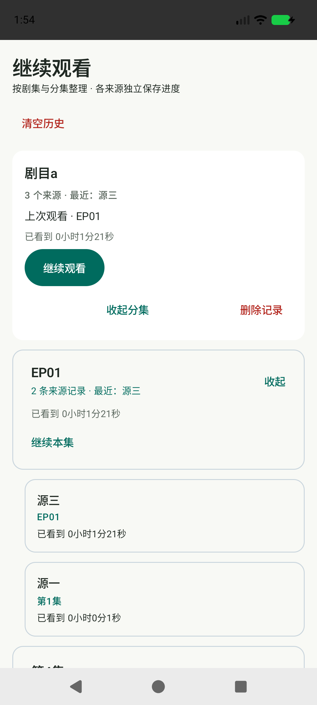

# v0.11.0：更新通道修复与分集历史

## 更新问题与验证

本轮将本机专用模拟器装回已发布、原签名的 0.9.0，使用 `PublishedUpgradeDeviceTest` 操作正式包的更新界面。复现命令：

```sh
adb shell am instrument -w -e publishedUpgrade true -e class org.streampocket.PublishedUpgradeDeviceTest org.streampocket.devtest.test/androidx.test.runner.AndroidJUnitRunner
```

结果为 `Missing 下载并安装; UI: … 检查失败：网络失败，请检查连接或换源`。当时系统 DNS 将 `api.github.com` 解析为代理虚拟地址 `198.18.0.97`，订阅网络 `PublicNetwork.dns` 明确拒绝该段；宿主直接请求 GitHub 匿名 API 也返回了 rate limit exceeded。公开 0.10.0 APK 可以下载，其 SHA-256 与 GitHub 发布资产记录一致。

这解释了本轮实际复现的失败路径；用户设备未提供具体错误信息，不能据此断言所有更新失败都只有这两个原因。

修复：

- `UpdateNetwork` 独立持有请求调度器与连接池，使用系统 DNS，支持代理的虚拟地址解析。仅允许本项目使用的 GitHub 官方 HTTPS 主机及官方资产跳转，逐次检查跳转，保留系统 TLS 证书验证。
- 不改变用户订阅的内网地址防护，不把更新通道开放给订阅 URL。
- API 失败时从 `https://github.com/ForXd/pocket-live/releases/latest/download/update.json` 获取同结构清单。清单与 APK 一起发布；0.10.0 补充了兼容清单，其 APK 未替换。
- 保留大小、哈希、包名、版本递增与签名校验；下载仍有预算、超时与取消清理，错误提示区分 DNS、超时与 TLS。
- AppModel 销毁时关闭独立更新连接，订阅/媒体请求的取消不再共享更新调度器。

回归覆盖：官方主机限制、非 HTTPS / 非官方跳转拒绝、限流备用清单、取消不触发备用请求、下载取消和残片清理、内容篡改拒绝、安装权限拒绝后重试与 content URI 安装。

`LiveUpdateNetworkDeviceTest` 使用修复后的真实网络通道下载 GitHub 正式 APK，与模拟器已安装正式包比对签名。开启 `completeProductionUpgrade=true` 后实际确认 Android 安装界面，并核对安装后的版本。已验证 0.9.0 → 0.10.0（2,652,471 字节，SHA-256 与原签名匹配），而非仅检查一个测试 Intent。发布后也已从公开 Release 完成 0.10.0 → 0.11.0 的下载、校验及系统确认安装。测试启动安装器时使用前台 Activity，与产品一致，避免复用系统旧安装结果任务。

**旧版升级方式：** 已安装 0.9.0 / 0.10.0 的代码不会因新 Release 自动修复。如果旧通道仍被当前网络拦截，需要手动下载 0.11.0 APK 覆盖安装一次，不要卸载；之后才使用新通道。新版继续保留订阅和历史。

## 剧集 → 分集 → 来源记录

- 第一层按原有剧集规则合并。
- 第二层按明确分集编号或规范化名称合并，如 `第01集`、`1`、`EP01`、全角数字属于同一集；上下集、特别篇、带季标记的不同名称不盲目混合。
- 每集下面保留各来源的原始名称和独立断点；“继续本集”选择该集最近一次记录，展开后可指定其他来源。
- 分集计数现在是聚合后的集数，来源条目数另行显示。排序仍按最近观看优先。
- 聚合仅影响呈现，原有最多 100 条底层历史记录、删除剧集和清空行为保持不变，无数据迁移。



## 本地验证

89 项单元测试通过。API 37 模拟器通过分集聚合、最近记录续播、不同来源断点选择、删除和清空、320dp / 150% 字号展开，以及历史存储回归。播放压力测试创建/释放播放器均为 50，弱引用残留 0、活动媒体请求 0，最大释放耗时 56ms。正式 APK 使用原签名，v2/v3 校验、覆盖安装和冷启动通过（0.11.0 / versionCode 17）。测试不等于所有实体手机与网络环境的兼容性保证。

后续发版需同时上传 `update.json`，从最终签名 APK 生成：

```sh
python3 scripts/release-manifest.py VERSION artifacts/VERSION/pocket-live-VERSION-release.apk --notes RELEASE_NOTES --out update.json
```

清单脚本计算真实文件大小与 SHA-256，避免手填校验值。Release 需保持正式版而非草稿/预发行版，并同时上传 APK、清单与校验和。
